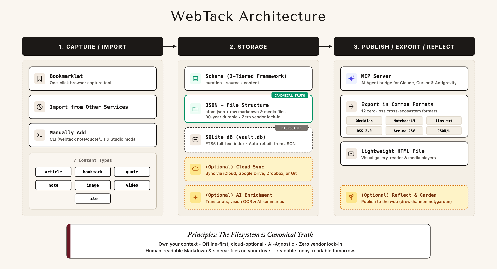
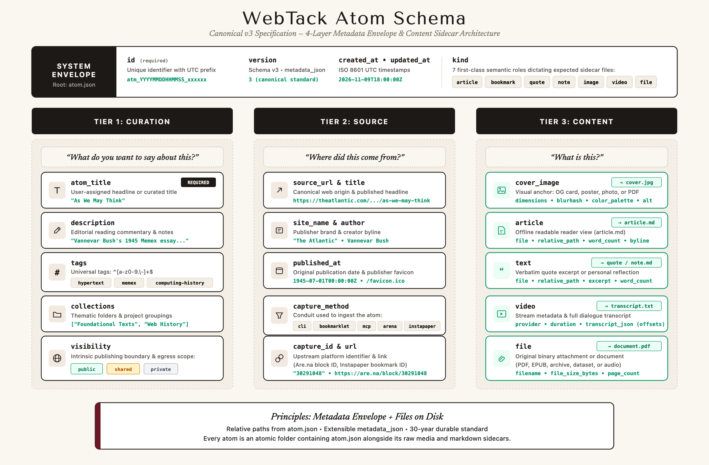

# WebTack

[](https://github.com/dn0c/webtack/actions/workflows/ci.yml)
[](https://www.python.org/downloads/)
[](LICENSE)
[-green.svg)](SPECIFICATION.md)
[](https://webtack.net)

A new open-source framework for saving and storing content from the web.  
**Website:** [https://webtack.net](https://webtack.net)

Decouples capture and long-term storage from proprietary platforms. The filesystem is the canonical source of truth; SQLite is a disposable, fast index.

<p align="center">
  
</p>

---

## Quickstart (Try it in 60 seconds)

Clone the repository and view the included sample vault:

```bash
# 1. Clone repository & install dependencies
git clone https://github.com/dn0c/webtack.git
cd webtack
pip install -r requirements.txt

# 2. Open the visual gallery viewer (auto-indexes the demo vault)
python3 viewer.py --vault fixtures/demo_vault

# 3. Or launch the local server with 1-click browser capture
python3 viewer.py --vault fixtures/demo_vault --server
```

---

## The 7 Kinds of Atoms

WebTack categorizes every curated piece of content into an explicit semantic `kind`:

| Kind | Role | Primary Content | Key Metadata |
| :--- | :--- | :--- | :--- |
| **`article`** | Longform essay, newsletter, or post | `cover.jpg` + `article.md` | `published_at`, `favicon`, `word_count`, `read_time`, `blurhash` |
| **`bookmark`** | Lightweight web pointer (tool, repo, site) | `cover.jpg` (OG card) | `source_url`, `favicon`, `blurhash`, `palette` |
| **`video`** | YouTube, Vimeo, or video stream | `cover.jpg` + `transcript.txt` | `provider`, `embed_url`, `captions_count`, `language` |
| **`quote`** | Attributed verbatim excerpt | `quote.md` | `author`, `source_url`, `word_count` |
| **`note`** | Personal thought, memo, or reflection | `note.md` | `word_count` (zero external URL required) |
| **`image`** | Photo, artwork, diagram, or scan | `cover.jpg` | `dimensions`, `aspect_ratio`, `blurhash`, `color_palette`, `alt_text` |
| **`file`** | Document, PDF, or attachment | `document.pdf` + `cover.png` | `file_size_bytes`, `file_extension`, `page_count` |

---

## WebTack Schema Specification (v3)

> For the formal data protocol, sidecar storage contracts, and extension rules, read the complete **[SPECIFICATION.md](SPECIFICATION.md)**.

Every atom is anchored by a canonical `atom.json` metadata sidecar structured into three decoupled knowledge tiers wrapped in a lightweight system envelope:

<p align="center">
  
</p>

```
┌────────────────────────────────────────────────────────┐
│  System Envelope (Document Header)                     │
│  (id, kind, version, created_at, updated_at, $schema)  │
├────────────────────────────────────────────────────────┤
│  Tier 1: Curation Layer                                │
│  (atom_title, notes, tags, collections, visibility)    │
├────────────────────────────────────────────────────────┤
│  Tier 2: Source Layer                                  │
│  (source_url, source_title, site_name, author, capture)│
├────────────────────────────────────────────────────────┤
│  Tier 3: Content Layer                                 │
│  (cover_image, article, text, video, file attachments) │
└────────────────────────────────────────────────────────┘
```

### System Envelope
Document identity, machine routing, and specification versioning.

| Field | Type | Description |
| :--- | :--- | :--- |
| **`id`** | `string` | Unique chronological identifier (e.g. `atm_20261105024437_b2e3c4`). |
| **`kind`** | `string` | Semantic discriminator: `article`, `bookmark`, `video`, `quote`, `note`, `image`, or `file`. |
| **`version`** | `integer` | Schema specification version (`3`). |
| **`created_at`** | `string (ISO 8601)` | Timestamp when the atom was first ingested into the vault. |
| **`updated_at`** | `string (ISO 8601)` | Timestamp of most recent edit or enrichment. |
| **`$schema`** | `string (URI)` | Canonical URL pointing to the JSON Schema validator. |

---

### Tier 1: Curation Layer (`curation`)
Editorial perspective, personal taxonomy, annotations, and privacy controls.

| Field | Type | Description |
| :--- | :--- | :--- |
| **`atom_title`** | `string` | Curated human-readable title (defaults to source title or user override). |
| **`notes`** | `string \| null` | Personal Markdown thoughts, synthesis, or commentary. |
| **`tags`** | `array[string]` | Normalized lowercase kebab-style slugs (e.g. `["systems-thinking", "design"]`). |
| **`collections`** | `array[string]` | Named project, reading list, or channel collections (e.g. `["Reading List"]`). |
| **`visibility`** | `string` | Egress classification: `public` (garden), `shared` (circle), or `private` (local machine only). |
| **`favorite`** | `boolean` | Starred/favorited status for quick filtering. |

---

### Tier 2: Source Layer (`source`)
Origin, attribution, publisher source, and upstream capture pipeline.

| Field | Type | Description |
| :--- | :--- | :--- |
| **`source_url`** | `string \| null` | Canonical public web address of the original content. |
| **`source_title`** | `string \| null` | Original HTML `<title>` or upstream publication headline. |
| **`site_name`** | `string \| null` | Publisher or platform name (e.g. `The New Yorker`, `YouTube`, `Substack`). |
| **`author`** | `string \| null` | Original author, artist, or channel creator. |
| **`published_at`** | `string (ISO 8601) \| null` | Original publication date if detected via metadata/Open Graph. |
| **`favicon`** | `string (URL) \| null` | Direct URL to the publisher's favicon. |
| **`capture_method`**| `string \| null` | Ingestion tool or pipeline (`cli`, `arena`, `instapaper`, `mcp`, `extension`). |
| **`capture_id`** | `string \| null` | Upstream item ID on source platform (e.g. Are.na block ID, Instapaper bookmark ID). |
| **`capture_url`** | `string (URL) \| null` | Direct link to the item on the upstream capture service. |

---

### Tier 3: Content Layer (`content`)
The immutable physical foundation: offline readable text, media streams, visual anchors, and attachments via a modular 5-slot architecture:

| Slot / Field | Type | Description |
| :--- | :--- | :--- |
| **`cover_image`** | `object \| null` | **Universal Visual Anchor**: photo, article OG card, video poster, or PDF preview. Holds `file`, `relative_path`, `mime_type`, `dimensions`, `aspect_ratio`, `blurhash`, `color_palette`, and `alt_text`. |
| **`text`** | `object \| null` | **Shortform Body**: quotes and notes. Holds `file` (`quote.md` or `note.md`), `excerpt` (inline markdown), and `word_count`. |
| **`article`** | `object \| null` | **Offline Longform Body**: extracted full text. Holds `file` (`article.md`), `word_count`, and `byline`. |
| **`video`** | `object \| null` | **Video & Transcripts**: stream player and audio captions. Holds `provider`, `embed_url`, `duration_seconds`, `transcript_file`, `transcript_json`, `transcript_language`, `transcript_is_generated`, and `has_transcript`. |
| **`file`** | `object \| null` | **Document Attachment**: document or binary file. Holds `filename`, `file_size_bytes`, `file_extension`, and `page_count`. |

---

### Overflow Bag (`metadata_json`)
A flexible JSON dictionary for niche, plugin, or experimental metadata without breaking canonical schema validation (e.g. detected reading speed, custom AI tags, color weights).

### Example Canonical Atom (`atom.json`)

```json
{
  "$schema": "https://raw.githubusercontent.com/dn0c/webtack/main/schema/atom.schema.json",
  "id": "atm_20261105024437_b2e3c4",
  "kind": "article",
  "version": 3,
  "created_at": "2026-11-05T12:00:00Z",
  "updated_at": "2026-11-05T12:00:00Z",
  "curation": {
    "atom_title": "On Information Routing",
    "description": "Essential thesis on treating productivity as a routing problem.",
    "tags": ["systems", "productivity"],
    "collections": ["Core Essays"],
    "visibility": "public",
    "favorite": true
  },
  "source": {
    "source_url": "https://example.com/essay",
    "source_title": "On Information Routing",
    "site_name": "Digital Garden",
    "author": "Drew Shannon",
    "published_at": "2026-11-05T08:00:00Z",
    "favicon": "https://example.com/favicon.ico",
    "capture_method": "cli",
    "capture_id": null,
    "capture_url": null
  },
  "content": {
    "cover_image": {
      "file": "cover.jpg",
      "relative_path": "atoms/2026/11/atm_20261105024437_b2e3c4/cover.jpg",
      "mime_type": "image/jpeg",
      "dimensions": { "width": 1200, "height": 630 },
      "aspect_ratio": 1.905,
      "blurhash": "L9RfkBxu~q-;-;j?IUt7afoeRQof",
      "color_palette": ["#1A202C", "#EDF2F7"],
      "alt_text": "Minimalist diagram of information nodes and network routing"
    },
    "text": null,
    "article": {
      "file": "article.md",
      "relative_path": "atoms/2026/11/atm_20261105024437_b2e3c4/article.md",
      "word_count": 2840,
      "byline": "Drew Shannon"
    },
    "video": null,
    "file": null
  },
  "metadata_json": {
    "reading_time_minutes": 13
  }
}
```

---

## Command Line Interface (CLI)

Run commands from the repository directory:

```bash
python3 -m pip install -r requirements.txt
```

### 1. Save a Link or Article (`curate.py link`)
Fetches Open Graph metadata, downloads the cover image (`cover.jpg`), extracts dominant colors + blurhash + aspect ratio, and saves the full offline readable article text (`article.md`):

```bash
python3 curate.py link "https://www.drewshannon.net/a-series-of-tubes/" \
  --tags "systems,tubes"
```

### 2. Save an Attributed Quote (`curate.py quote`)
Captures an exact quote, calculates word count, and anchors it to author and source provenance:

```bash
python3 curate.py quote "Productivity is an information routing problem, not an attention shortage problem." \
  --author "Drew Shannon" \
  --source "https://www.drewshannon.net/a-series-of-tubes/" \
  --tags "productivity,systems"
```

### 3. Save a Personal Note (`curate.py note`)
Captures an original reflection or memo (no external URL required):

```bash
python3 curate.py note "Information routing is the architecture of thought." \
  --tags "systems,philosophy"
```

### 4. Save an Image (`curate.py image`)
Captures a local photo or direct web image URL, computes aspect ratio, blurhash, and color palette:

```bash
python3 curate.py image "/path/to/diagram.png" \
  --title "Information Routing Funnel" \
  --tags "diagram,systems"
```

### 5. Save a Local File or Document (`curate.py file`)
Ingests any local document (PDF, CSV dataset, whitepaper, archive) into the vault with gentle enrichment: calculates file size, SHA-256 hash, extracts PDF page counts and QuickLook thumbnail previews, and indexes text excerpts:

```bash
python3 curate.py file "/path/to/whitepaper.pdf" \
  --title "Next-Generation Information Architecture" \
  --author "Vannevar Bush" \
  --tags "research,systems" \
  --collection "Reading List"
```

### 6. List Saved Atoms (`curate.py list`)
List recent atoms with optional filtering by `kind`, `tag`, `collection`, or keyword query (`-q`):

```bash
python3 curate.py list
python3 curate.py list -q "architecture"
python3 curate.py list --kind file
python3 curate.py list --kind quote
python3 curate.py list --kind bookmark
python3 curate.py list --tag systems
```

### 7. Instant Full-Text Search (`curate.py search`)
Powered by native SQLite FTS5 with BM25 relevance ranking. Searches across titles, authors, curator notes, tags, full article reader markdown, and spoken video transcript dialogue in sub-milliseconds:

```bash
# Search across your entire vault with highlighted snippet excerpts:
python3 curate.py search "distributed systems"
python3 curate.py search "paxos" --kind article
python3 curate.py search "engelbart" --kind video
```

### 8. Visual Gallery & Live Capture Studio (`curate.py view`)
Browse your vault with high-aesthetic typography, 4-tier schema inspection, responsive video player, and distraction-free reader mode:

```bash
# Zero-Terminal macOS Launcher:
# Simply double-click "Launch WebTack.command" in Finder!

# Or launch via terminal:
python3 curate.py view --server
```

**In-Browser Studio Features:**
- **`+ Capture` Modal (`c`)**: 1-click capture tabs for **Articles** (scraped Markdown), **Bookmarks** (lightweight pointers), **Videos** (posters & optional user transcriptions), **Quotes**, **Notes** (Markdown), and **Images** (blurhash & color extraction).
- **`📥 Export ▾` Menu**: 1-click browser downloads for:
  - 🤖 **NotebookLM Digest (`.md`)**: Unified longform document with articles, notes, quotes, and full video transcripts.
  - 📑 **`llms.txt` Index (`.txt`)**: Compact, LLM-friendly index standard.
  - 🧱 **Are.na CSV (`.csv`)**: Import-ready file for Are.na channels.
  - 💾 **Full Vault Backup (`.json`)**: Complete raw schemas & metadata.
- **⚡ Bookmarklet**: Drag the "Save to WebTack" bookmarklet to your browser's favorites bar for 1-click capture from any web page.

---

## AI Integration: Model Context Protocol (MCP)

WebTack includes an embedded [Model Context Protocol](https://modelcontextprotocol.io/) (MCP) server so AI assistants (**Claude Desktop**, **Antigravity**, **Cursor**) can search and read from your vault.

### 1. Claude Desktop Setup
Add this to your Claude Desktop configuration (`~/Library/Application Support/Claude/claude_desktop_config.json` on macOS):

```json
{
  "mcpServers": {
    "webtack": {
      "command": "python3",
      "args": [
        "/ABSOLUTE/PATH/TO/webtack/webtack_mcp.py"
      ]
    }
  }
}
```

### 2. Available AI Tools
Once connected, your AI assistant can invoke:
- `search_vault(query, kind, tag)`: Fast search across titles, notes, article text, and transcripts.
- `get_atom(atom_id)`: Retrieve full structured metadata and offline content body.
- `get_transcript(atom_id)`: Read timestamped dialogue for any video.
- `get_article(atom_id)`: Read the full offline Markdown body for any article.
- `save_note(text, title, tags)`: Save a new thought directly into your vault.
- `save_bookmark(url, title, tags)`: Bookmark a web link into your vault.

---

## Knowledge Exports & Data Portability

WebTack guarantees your knowledge is never held hostage in a proprietary silo. You can export your library into 13 open standards via the **Export Hub** (`/export.html`) or the CLI:

| Target | Command | Primary Ecosystem | Output File |
| :--- | :--- | :--- | :--- |
| **NotebookLM Digest** | `curate.py export --target digest` | NotebookLM, Claude Projects | `vault_digest.md` |
| **Obsidian Vault** | `curate.py export --target obsidian` | Obsidian, Logseq, Foam | `vault_obsidian.zip` |
| **HTML Bookmarks** | `curate.py export --target bookmarks-html` | Chrome, Safari, Firefox, Arc | `bookmarks.html` |
| **Raindrop.io CSV** | `curate.py export --target raindrop-csv` | Raindrop.io Collections | `raindrop_export.csv` |
| **Readwise Highlights**| `curate.py export --target readwise` | Readwise, Reader | `readwise.csv` |
| **`llms.txt` Index** | `curate.py export --target llms-txt` | LLM Agents, Context Optimization | `llms.txt` |
| **Are.na CSV** | `curate.py export --target arena-csv` | Are.na Channels | `arena_export.csv` |
| **Pinterest Bulk CSV** | `curate.py export --target pinterest-csv` | Pinterest Business, Visual Boards | `pinterest_pins.csv` |
| **SQLite Vault CSV** | `curate.py export --target csv` | Excel, Google Sheets, SQLite/Postgres | `vault.csv` |
| **RSS 2.0 Feed** | `curate.py export --target rss` | Feedly, NetNewsWire, RSS Readers | `feed.xml` |
| **BibTeX Citations** | `curate.py export --target bibtex` | Zotero, LaTeX, Mendeley | `vault.bib` |
| **JSONL Dataset** | `curate.py export --target jsonl` | Vector Embeddings, LangChain, RAG | `vault.jsonl` |
| **Full Raw Backup** | `curate.py export --target json` | Disaster Recovery, Migration | `vault_backup.json` |

To browse, search, and download all exports in your browser, click **📦 Export Center** in the top navigation bar of the web gallery (`/export.html`).

---

## The Enrichment Lifecycle

WebTack follows two core operational rules:
1. **Ingress is lightweight; enrichment is layered.** Capturing content should never fail or hang because an external AI service is down or audio transcription takes 30 seconds. Fast metadata is saved immediately at ingestion (`curate.py`); heavy semantic layers (vision alt-text, speech transcripts, full-text backfills) are layered onto atom sidecars asynchronously whenever you choose.
2. **Sovereign Fidelity & Layered AI Involvement.** You decide exactly what enters your vault—down to the byte—and no more. Saving a lightweight bookmark pointer never forces asset downloads or unexpected AI token consumption.

```
┌────────────────────────────────────────────────────────┐
│  Phase 1: Ingestion-Time Enrichment (curate.py)        │
│  Fast, synchronous (0–2s) at the moment of capture     │
├────────────────────────────────────────────────────────┤
│  Phase 2: Deep / Asynchronous Enrichment (scripts/)    │
│  Heavy, optional, offline batch or on-demand pipelines │
└────────────────────────────────────────────────────────┘
```

### The 4 Levels of AI Involvement (Strictly Opt-In)

| Level | Mode | Network Egress | Description |
| :--- | :--- | :--- | :--- |
| **Level 0** | **Pure Determinism (Zero-AI)** | Zero | Raw URL metadata, embedded EXIF/IPTC image captions, HTML `<figcaption>` scraping. 100% offline, zero keys, zero tokens. |
| **Level 1** | **On-Device Neural (Local AI)** | Zero | Apple Silicon Neural Engine / native macOS Vision (`VNRecognizeTextRequest` + `VNClassifyImageRequest`). Processes images and OCR locally on hardware without sending bytes to the web. |
| **Level 2** | **Self-Hosted Local LLM** | Local Network | Optional self-hosted models (Ollama, vLLM, llama.cpp) for local article summarization or tagging. |
| **Level 3** | **Cloud Generative AI** | User-Configured API | Multi-provider cloud models (Gemini, OpenAI, Anthropic, Groq, OpenRouter) requiring explicit API keys in `.env` for deep synthesis, article summarization, or captioning. |

### Configuring Generative AI Keys (`.env`)

WebTack works 100% offline with zero keys. To enable **Level 3 AI superpowers**—automatic 2–3 sentence article summaries and accessibility image alt-text—copy `.env.example` to `.env` and set any **one** of the supported provider keys:

```bash
# Recommended: Fast, high-throughput, low-cost
GEMINI_API_KEY=your_gemini_api_key

# Or any of these alternatives:
OPENAI_API_KEY=your_openai_api_key        # gpt-4o-mini
ANTHROPIC_API_KEY=your_anthropic_api_key  # claude-3-5-haiku
GROQ_API_KEY=your_groq_api_key            # llama-3.3-70b / llama-3.1-8b
OPENROUTER_API_KEY=your_openrouter_api_key
```

**What happens when an AI key is configured:**
1. **At Ingestion:** Saving any article (`curate.py article <url>`, or auto-detected via `curate.py save <url>`, Instapaper sync, or Web UI quick-capture) automatically generates a concise 2–3 sentence summary dynamically labeled with the exact AI tool that created it (e.g. `[AI Summary: Gemini]`, `[AI Summary: Claude]`, `[AI Summary: OpenAI]`) in the atom's description. Any human curator notes provided via `-n / --notes` are preserved at the top. (Pass `--no-enrich` to skip).
2. **In Batch:** Running `curate.py enrich --target articles` scans your vault and backfills AI summaries across existing articles using the configured model.
3. **For Images:** Automatically generates descriptive accessibility `alt_text` for photos and graphics during capture or via `curate.py enrich --target images`.

---

### Phase 1: Ingestion-Time Enrichment (`curate.py`)
Runs automatically during capture to ensure instant visual parity in the viewer:
* **Articles:** Trafilatura extracts clean markdown into `article.md`, calculates `word_count` and `read_time`, downloads the hero image, fetches the site's `favicon`, and generates a crisp 2–3 sentence summary labeled `[AI Summary: Provider]` in the atom description (if an AI key is configured in `.env`, or falls back to publisher description; skipped with `--no-enrich`).
* **Bookmarks:** Scrapes OpenGraph tags (`og:title`, `og:description`, `og:image`) and calculates the `blurhash` and `color_palette` for instant progressive rendering in the UI.
* **Quotes:** Normalizes typography (curly quotes, em-dashes), captures creator attribution, and saves clean markdown in `quote.md`.
* **Videos:** Scrapes channel name, duration, and high-res video thumbnail.

---

### Phase 2: Deep / Batch Enrichment (`curate.py enrich` & scripts)
Runs asynchronously, in the background, or in batch when you want to upgrade your library:

| Target | Command | What it Adds to the Atom |
| :--- | :--- | :--- |
| **All / Unified Enrichment** | `curate.py enrich`<br>*(runs `scripts/enrich.py`)* | Batch processes both image alt-text and article AI summaries across the vault. |
| **Article AI Summaries** | `curate.py enrich --target articles` | Generates 2–3 sentence AI summaries labeled `[AI Summary: Provider]` into `curation.description`. |
| **Image Vision & Accessibility** | `curate.py enrich --target images` | Resolves rich, descriptive accessibility `alt_text` using the 5-tier resolution engine. |
| **Spoken Dialogue & Audio** | `curate.py attach-transcript` / `backfill-transcripts` | Attaches dialogue into `transcript.txt` and timestamped cues in `transcript.json` from user-supplied files (.txt, .vtt, .srt) or folder. |
| **Full Article Text** | `scripts/backfill_instapaper_fulltext.py` | Upgrades lightweight bookmark pointers into full offline `article.md` reading sidecars. |
| **Quote Sources & Authors** | `scripts/enrich_quotes_deep.py` | Matches quotes against publication domains to resolve missing author attributions. |

#### Accessibility Alt Text & Vision Engine (`curate.py enrich`)

WebTack resolves accessibility alt text through a cascading **5-tier resolution engine**:
1. **Embedded Metadata (EXIF/IPTC)**: Reads photographer descriptions stored inside the image binary (0ms, zero keys).
2. **Upstream Web Scraping**: Extracts `<figcaption>`, ``, or `og:image:alt` from the source webpage (zero keys).
3. **Multi-Provider Cloud Vision**: If configured in `.env`, generates rich narrative descriptions via **Gemini** (`GEMINI_API_KEY`), **OpenAI** (`OPENAI_API_KEY`), **Anthropic** (`ANTHROPIC_API_KEY`), **Groq** (`GROQ_API_KEY`), or **OpenRouter** (`OPENROUTER_API_KEY`).
4. **Native macOS Vision**: Offline fallback using Apple Silicon Neural Engine (`VNRecognizeTextRequest` + `VNClassifyImageRequest`) for local OCR and scene classification (zero keys, zero network).
5. **Fallback**: Gracefully uses the atom title or curator description.

```bash
# Enrich images missing alt text
python3 curate.py enrich

# Force regenerate alt text for up to 10 images
python3 curate.py enrich --limit 10 --force
```

---

## Upstream Integrations (`integrations/`)

WebTack is designed to be local-first and platform-agnostic. Optional connectors to external services live in the modular `integrations/` folder:

* **Are.na** (`integrations/arena/`):
  * Import entire channels: `python3 integrations/arena/import_channel.py <channel-slug>`
  * Inbound feed sync: `python3 integrations/arena/sync.py`
  * Two-way alt text sync: `python3 integrations/arena/sync_alt_text.py`
* **Instapaper** (`integrations/instapaper/`):
  * Sync unread reading list with parsed readability text: `python3 integrations/instapaper/sync.py`
* **Google Cloud Storage** (`integrations/gcs/`):
  * Sync public assets & `curation_public.json` to GCS for your digital garden: `python3 integrations/gcs/sync.py`

You can also run automated inbound pulls across configured services using:

```bash
# Pull new items from configured services
python3 curate.py pull
```

---

## Sync to Public Garden (`curate.py sync`)

Publishes public atoms to your live digital garden (e.g., `drewshannon.net/garden`):
1. Exports `curation_public.json` containing metadata, tags, and excerpts for atoms where `visibility = 'public'` (keeps private atoms local-only).
2. Uploads the manifest to Google Cloud Storage (`gs://<your-bucket-name>/curation_public.json`).
3. Rsyncs public cover images to `gs://<your-bucket-name>/atoms/`.

```bash
# Full sync: manifest + image assets
python3 curate.py sync

# Fast sync: manifest only (instant updates for tags/titles/notes)
python3 curate.py sync --manifest-only
```

---

## Disaster Recovery (`reindex`)

Deletes `vault.db`, walks your local `atoms/` directory, and reconstructs the entire SQLite search database from the `atom.json` sidecars in seconds:

```bash
python3 curate.py reindex
```

---

## Schema & Sidecar Validation (`validate`)

Lints every `atom.json` against the formal JSON schema and verifies that all referenced media/markdown sidecars exist on disk:

```bash
# Validate entire vault
python3 curate.py validate

# Validate the demo vault
python3 curate.py validate --vault fixtures/demo_vault

# Validate a specific atom
python3 curate.py validate --atom atm_20261108200100_demoart
```

---

## Vault Architecture

```text
webtack/
├── curate.py                 # Core CLI ingestion & pipeline engine
├── viewer.py                 # Visual presentation & local capture server
├── webtack_mcp.py            # Model Context Protocol (MCP) server for AI tools
├── requirements.txt          # Python dependencies
├── LICENSE                   # Open source license (MIT for code, CC0 for schema)
├── SPECIFICATION.md          # Formal architectural specification & storage contract
├── schema/
│   └── atom.schema.json      # Formal JSON Schema specification (v3)
├── docs/
│   └── assets/               # Architecture diagrams & visual schema specs
├── fixtures/
│   └── demo_vault/           # Self-contained specimen vault (6 canonical kinds)
└── vault/                    # Canonical user vault (gitignored / syncable)
    ├── vault.db              # Disposable SQLite search catalog
    ├── index.html            # Zero-dependency single-page visual gallery
    ├── export/               # Generated LLM digests & export files
    └── atoms/
        └── YYYY/
            └── MM/
                └── atm_YYYYMMDD.../
                    ├── atom.json      # 4-tier structured metadata envelope (System Envelope, Curation, Source, Content)
                    ├── cover.jpg      # Universal visual preview (480px, blurhash, palette)
                    ├── article.md     # Offline readable article text (for articles)
                    ├── transcript.txt # Timestamped spoken dialogue (for videos)
                    ├── transcript.json# Machine-readable dialogue offsets
                    ├── note.md        # Formatted markdown thoughts (for notes)
                    └── quote.md       # Formatted markdown quote/excerpt (for quotes)
```

---

## License

- **Software & Tooling** (`curate.py`, `viewer.py`, `webtack_mcp.py`, etc.): [MIT License](LICENSE)
- **Schema & Specification** (`schema/atom.schema.json`): [Creative Commons Zero v1.0 Universal (CC0 1.0)](LICENSE)

