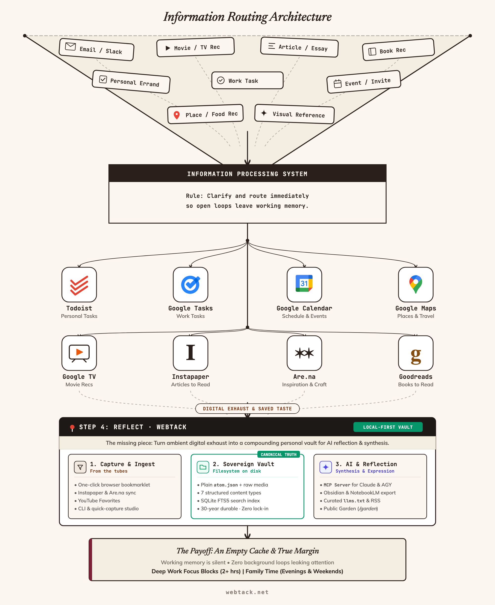
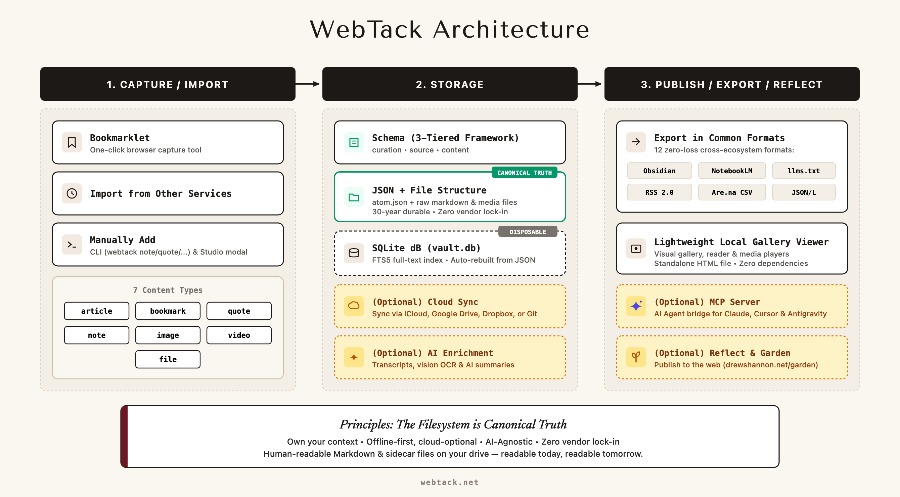
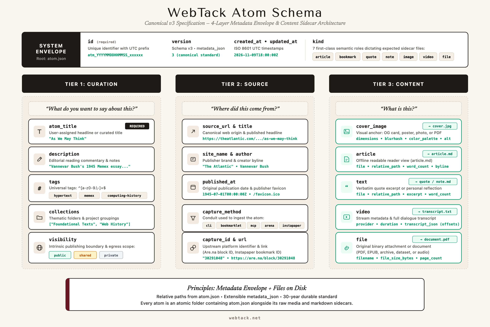

# Introducing WebTack - a new open-source framework for saving and storing content from the web.

Bookmarking tools have long been some of my favorite corners of the internet.

Between Pinterest, Pinboard, Instapaper, [Are.na](https://www.are.na), Sublime, Cosmos, [Raindrop.io](https://raindrop.io), and countless more, they’re largely free of “[dark patterns](https://en.wikipedia.org/wiki/Dark_pattern)” and algorithmic feeds, and they provide users with a quiet (or private) place to save the things that are important to them—links, recipes, outfits, online shopping lists, articles, notes, inspiration, etc.

In a world where so much of one’s online life is mediated by the social graph, I think they’re capable of reflecting one’s “true” self in a way other online tools can’t.

The downside of these tools is that they often make it difficult for you to get your content “out”, leading to limited portability and high switching costs if another player comes on the market.

I’ve been a very happy (paying) customer of tools like [Are.na](https://www.are.na) and Instapaper for many years, and I want to continue paying them for their incredible product designers, engineers, and apps. But I want to pay them for their software as an interface layer *on top* of my contextual data, not the data itself. If another tool comes around that has better social features, a more pleasant UI, or advanced technical capabilities, I want to switch and bring my data with me.

Over the last decade-plus, I’ve saved nearly 15,000 pieces of content—quotes, articles, links, images, etc. In contrast to “digital exhaust” (the valuable digital detritus that we passively accumulate as a result of living online), these items reflect an intentional choice: “this is important to me; this is something I want to save.”

This is a bit of a twist on—or perhaps the logical conclusion of—what I’ve been [thinking about lately](https://www.linkedin.com/feed/update/urn:li:activity:7464732747652071424/), and discussed in a [recent post](https://www.drewshannon.net/a-series-of-tubes/) about stimulation overload and information processing. In a world where lots of stuff is coming at you, it’s crucial to have a system to triage and process that information. Some of that information will become tasks, other information will become reference material you want to save for later.

*Triaging the stream: separating transient digital exhaust from reference material worth saving.*

---

## Introducing WebTack

Introducing [WebTack](https://webtack.net), a project I’ve been working on lately: an open-source framework for saving and storing content from the web.

It’s pretty simple:

1. **Save the online content that’s important to you** (whether it’s imported from an existing service, or added via our Bookmarklet or CLI)
    - 7 content types: Bookmarks, Articles, Images, Files, Quotes, Notes, or Videos
    - 50+ optional metadata fields 
2. **Your content is saved to your local machine in a specific file structure, simultaneously building:**
    - A SQLite database created to give you instant search capabilities
    - Structured JSON schema designed to capture important metadata such as Privacy, Source, Author, File Size, image dimensions, Tags, etc
3. **Once you’ve built your database, the data is yours, to do what you wish. You could:**
    - Sync it to the cloud, for access on any device.
    - Build a custom UI on top of it as an alternative to the public platforms
    - Use the included MCP Server to hook it up to your local Agentic AI tool to enrich your data (“look through all my saved images and suggest alt text to add to improve accessibility”)
    - AI assisted search (“based on these YouTube videos I’ve saved, what other creators might I be interested in?”)
4. **(Optional) Export your data**
    - We provide 10+ export templates to prepare your data for ingestion into tools like Obsidian, Readwise, RSS, and more.
    - Publish on the web. Want to see an example? Visit [drewshannon.net/garden](https://drewshannon.net/garden)

*WebTack architecture: local-first vault, open JSON sidecars, disposable SQLite cache, and extensible interfaces.*

---

## Why Local-First Archiving Matters

Even if you choose to continue using an established tool like Pinterest, there are great benefits to WebTack as an offline backup or archive:

- **Redundancy / backups** - these platforms could theoretically go down at any moment, so if you’ve put sentimental, professional, or creative importance on this content, having a local copy will give you peace-of-mind.
- **Cross-platform utility** - I’ve personally imported Articles from Instapaper, Images from [Are.na](https://www.are.na), and Quotes from Kindle. Having them all in 1 place is pretty cool.
- **Expandability** - Bookmarking tools only have so much metadata, but it may be important for you to store other important context. 
- **Flexibility** - Having local copies of your saved content, as well as a robust schema of metadata, gives you nearly unlimited control over what to do with it. 
- **Own your Data** - When you store your data with a major provider, you’re at the whim of their product & business decisions. Take that control into your own hands. 

*The WebTack Atom Schema: a 3-tier decoupled model preserving editorial intent, source provenance, and raw content.*

---

Curious to check it out or build on it? Visit [https://webtack.net](https://webtack.net) and get started in less than 1 minute. Free forever, no account needed.
